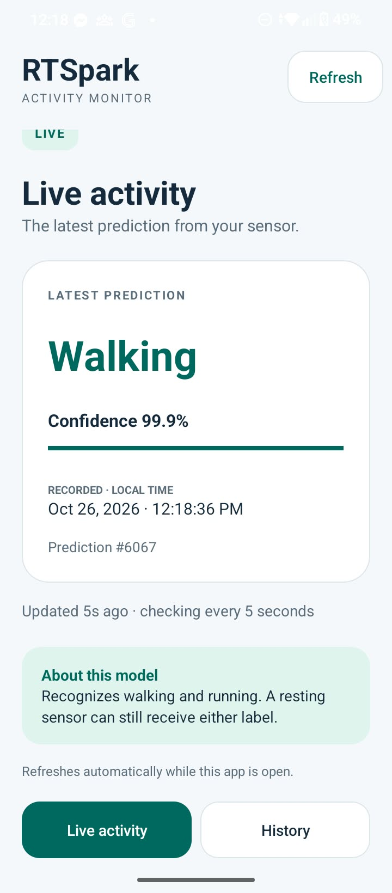
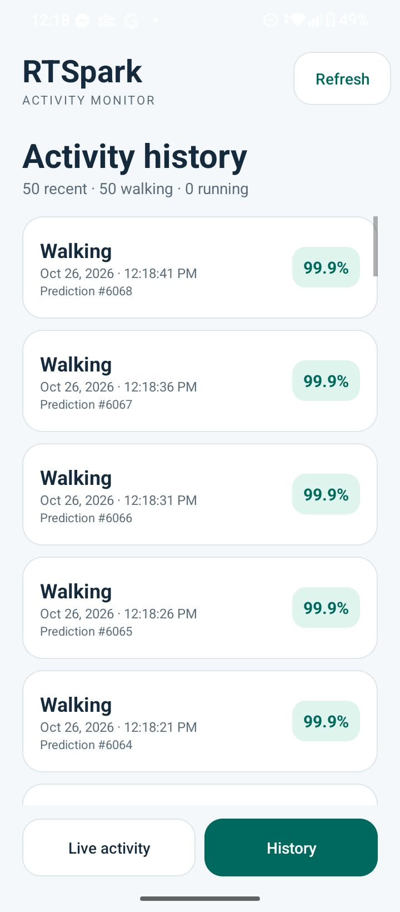

# RT-Spark Activity Recognition

An end-to-end IoT laboratory project that collects motion readings on an
RT-Spark board, classifies walking and running in the cloud, and displays live
predictions and history in an Android app.

**STM32F407ZG · ICM20608 · RW007 · MQTT/TLS · PyTorch · Flask · SQLite · Kotlin**

The complete implementation is maintained on `main`. Firmware programming,
cloud deployment, Android operation and the six-trial movement evaluation are
documented. The final live PyTorch result is **29/53 windows correct (54.7%)**;
jogging recognition remains the main limitation.

**Start here:** [Setup guide](docs/RTSPARK_SETUP.md) ·
[Completion review](docs/LAB_COMPLETION.md) ·
[Test evidence](docs/testing/README.md) · [Documentation index](docs/README.md)

## What the project does

The board publishes six motion axes to `activity/sensor` over authenticated
MQTT/TLS. A cloud subscriber collects five ordered readings, applies a
450-parameter PyTorch GRU, saves the prediction in SQLite and publishes it to
`activity/prediction`. The Android app reads the Flask API over HTTPS.

| Component | Implementation |
| --- | --- |
| Motion sensing | ICM20608 accelerometer and gyroscope over I2C2 |
| Embedded application | STM32Cube/HAL, PlatformIO and RW007 Wi-Fi over SPI2 |
| Device transport | AWS coreMQTT 2.3.1 serialization, QoS 1 and verified TLS |
| Cloud inference | PyTorch GRU, five readings per window, Walking/Running labels |
| Storage and API | SQLite prediction history and Flask latest/history endpoints |
| Android client | Kotlin, Volley, Live/History views and automatic refresh |

The supplied handout also names different reference hardware. The actual
ICM20608/RW007 adaptation is explained in
[hardware/toolchain notes](docs/LAB_COMPLETION.md#hardwaretoolchain-reference-differences).

## Android app

| Live activity | Activity history |
| :---: | :---: |
|  |  |

Screenshots were captured after the October 26, 2026 PyTorch deployment.
The percentage on a card is model confidence; measured movement accuracy is
reported below. See the [screenshot evidence](docs/testing/2026-10-26_pytorch_android_public.md).

## Repository guide

| Folder | Contents |
| --- | --- |
| [firmware/](firmware/README.md) | Active PlatformIO firmware, drivers, CubeMX configuration and build instructions |
| [cloud/](cloud/README.md) | Model, training pipeline, MQTT subscriber, database and API |
| [android_app/](android_app/README.md) | Android Studio project and client configuration |
| [data_collection/](data_collection/README.md) | Earlier serial capture, unit conversion and gateway tools |
| [docs/](docs/README.md) | Setup, completion review, dated evidence and archived reports |
| [tests/](tests/README.md) | Model/API, firmware, CubeMX and deployment-helper tests |
| [tools/](tools/) | Dataset download, deployment, evaluation and archived RT-Thread helpers |

## Get started

Clone the project and run commands from its root:

```powershell
git clone https://github.com/msyennna/rt-spark-activity-recognition.git
cd rt-spark-activity-recognition
python -m venv .venv
.\.venv\Scripts\Activate.ps1
python -m pip install -r requirements.txt
```

### Cloud services

Start Mosquitto separately with a local listener on `localhost:1883`.
Run these commands in two terminals with the same Python environment activated:

```powershell
python -m cloud.mqtt.mqtt_classifier
```

```powershell
python -m cloud.api.app
```

The API listens on port `5000`; SQLite is created automatically at
`cloud/database/activity.db`. These commands start the local development
services. The [setup guide](docs/RTSPARK_SETUP.md) describes the lab's
MQTT/TLS and HTTPS deployment. The repository includes the trained PyTorch
checkpoint and metadata; the training dataset is downloaded separately.

### Firmware

Install PlatformIO Core and configure local Wi-Fi/MQTT settings using the
supplied example headers:

```powershell
Copy-Item firmware/include/rw007_wifi_config.example.h firmware/include/rw007_wifi_config.h
Copy-Item firmware/include/rtspark_private.h.example firmware/include/rtspark_private.h
```

Fill in those local headers, then validate and build:

```powershell
python firmware/scripts/check_cubemx.py
pio run -d firmware
```

Follow [firmware/README.md](firmware/README.md) for CubeMX review, ST-LINK
programming and serial monitoring. Private headers and compiled firmware are
excluded from Git because the compiled image contains the configured secrets.

### Android

Open `android_app/` in Android Studio and follow the
[Android guide](android_app/README.md). The API hostname and public CA are
configured for the original lab deployment; configure both for your own server.

## Sensor and API contract

One MQTT message contains all six numeric fields. Acceleration is in **g** and
angular velocity is in **rad/s**; firmware schedules a nominal one-second interval.

```json
{
  "acceleration_x": 0.01,
  "acceleration_y": -0.02,
  "acceleration_z": 1.01,
  "gyro_x": 0.001,
  "gyro_y": -0.002,
  "gyro_z": 0.003
}
```

| Method | Endpoint | Response |
| --- | --- | --- |
| GET | `/` | Service name and status |
| GET | `/api/activity/latest` | Latest prediction; `404` when no predictions exist |
| GET | `/api/activity/history?limit=50` | Count and newest-first records; limit bounded to 1–500 |

The classifier resets incomplete windows after invalid readings, reconnects or
delivery gaps over 2.5 seconds. A prediction includes an activity ID, label,
confidence and stored timestamp. See the [cloud guide](cloud/README.md).

## Recorded results

| Evaluation | Correct / windows | Accuracy |
| --- | ---: | ---: |
| PyTorch development out-of-fold | 2,219 / 2,258 | 98.27% |
| PyTorch untouched two-day dataset holdout | 1,197 / 1,300 | 92.08% |
| PyTorch live board evaluation: six valid trials | 29 / 53 | **54.7%** |

The live evaluation recorded Walking **26/26** and jogging/Running **3/27**.
The original session was independently replayed and audited. Dataset scores
come from evaluation before the final deployment refit; they describe a
different evaluation from the live board trial.

The project demonstrates the complete device-to-phone pipeline. The measured
live result shows weak jogging generalization under the tested conditions.
The model has two classes and no resting class, and confidence does not measure
accuracy. Earlier Random Forest results remain historical evidence.

See the [model methodology](cloud/classifier/README.md),
[original-session audit](docs/testing/2026-10-27_pytorch_walk_jog_audit.md) and
[completion review](docs/LAB_COMPLETION.md) for the evidence and its limits.

## Validation and reports

Use the [test guide](tests/README.md) to run the existing offline checks, and
the [evidence index](docs/testing/README.md) to inspect the recorded builds,
programming results, cloud deployment, phone observations and movement tests.
The [report archive](docs/reports/README.md) preserves the earlier reports
from `main` and explains which implementation they describe.
